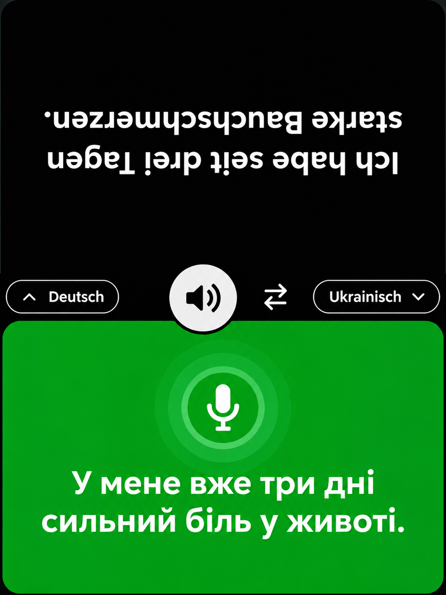
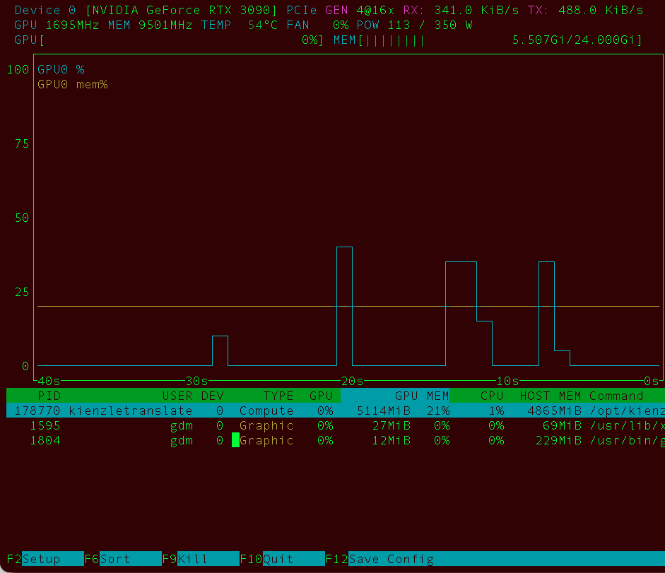

# kienzletranslate v1.1

Lokaler Gesprächsübersetzer für zwei gegenüber sitzende Personen mit einem
iPad im Hochformat. PHP-Webapp und ein zentraler SeamlessM4T-v2-Large-Modellservice
laufen auf einem Linux-Rechner mit NVIDIA-GPU. Native Installation ohne Docker.

<p align="center">
  
  <br>
  <em>Oberflächenentwurf · Gegenübersitzen, gedrückt halten, sprechen und übersetzen.</em>
</p>

**Modelllizenz: CC BY-NC 4.0 — nur nichtkommerzielle Nutzung.** Die Lizenz der
Anwendung (MIT) erlaubt keine darüber hinausgehende Nutzung der Modellgewichte.
Der Installer und die iPad-Zertifikatsseite verlangen eine ausdrückliche
Bestätigung durch `AKZEPTIEREN` oder `ACCEPT`. [Lizenzdetails](docs/LICENSES.md).
Technischer Prototyp; keine medizinische Validierung. Testdaten verwenden.

<p align="center">
  
  <br>
  <em>Lokaler GPU-Betrieb · Momentaufnahme auf einer NVIDIA GeForce RTX 3090 mit 24 GB Grafikspeicher.</em>
</p>

## Installation / Update

Getestetes Ziel: Ubuntu 24.04, Python 3.12, NVIDIA RTX 3090 (24 GB), vorhandener
funktionsfähiger NVIDIA-Treiber. Rund 25 GB freier Speicher für Modell und
Python/CUDA-Abhängigkeiten vorsehen. Debian wird vom Installer ebenfalls
unterstützt, wurde aber nicht als zweite Plattform abgenommen.

```sh
git clone https://github.com/thomaskien/kienzletranslate.git
cd kienzletranslate
sudo bash install.sh
```

Erste Abfrage: Deutsch/English. Anschließend Lizenzbestätigung, Server-IP,
optionaler DNS-Name, HTTP-/HTTPS-/Modellport, Installations- und Modellpfad sowie
optionalen Passwortschutz (standardmäßig aus). Ohne Passwortschutz öffnet sich
die App direkt. Wird der Schutz eingeschaltet, lässt sich ein Passwort festlegen;
eine leere Eingabe erhält das bestehende oder erzeugt ein sicheres Passwort.
Aufrufadressen und gegebenenfalls das erzeugte Passwort liegen auf dem Server in
`/root/kienzletranslate-access.json` (nur für root lesbar). Updates erhalten die
ausdrücklich gewählte Einstellung.

Für Updates den neuen Quellstand holen und denselben Installer aufrufen.
Konfiguration und lokale CA bleiben erhalten; vorheriger Stand wird gesichert.
Nach einem fehlgeschlagenen abschließenden Gesundheitscheck versucht der Installer,
auf die vorherige Veröffentlichung zurückzuwechseln. Systempakete und bereits
installierte Python-Abhängigkeiten werden dabei nicht automatisch zurückgestuft.

Ausführliche Einrichtung: [INSTALLATION.md](docs/INSTALLATION.md).

## Bedienung

- Zwei Sprachen auswählen, unten standardmäßig Deutsch, oben Ukrainisch.
- Häufig in Deutschland verwendete Sprachen stehen in einer ersten alphabetischen
  Gruppe, alle übrigen in einer zweiten alphabetischen Gruppe.
- Die Oberfläche ist in den Einstellungen zwischen Deutsch und Englisch umschaltbar;
  diese Wahl verändert die Übersetzungssprachen nicht und wird lokal gespeichert.
- Mikrofon einmal aktivieren. Es bleibt im Vordergrund für den lokalen Vorlauf
  geöffnet. Im Leerlauf werden keine Audiodaten übertragen.
- Eigene Hälfte gedrückt halten, sprechen, loslassen. Grün bedeutet Aufnahme;
  die Verarbeitung beginnt nach dem Loslassen.
- Originaltext erscheint auf der Sprecherseite, Übersetzung gegenüber. Nur der
  obere Gesprächstext ist gedreht, alle Bedienelemente bleiben aufrecht.
- Die Schriftgröße passt sich automatisch so an, dass der gesamte Text in die
  jeweilige Hälfte passt. Lange Texte werden entsprechend kleiner dargestellt.
- Lautsprecher schaltet die übersetzte Sprachausgabe ein/aus. Eine neue Aufnahme
  unterbricht laufende Wiedergabe.
- Vorlauf: 0–3 s in 250-ms-Schritten, standardmäßig 1 s. Einstellungen ermöglichen
  außerdem das Laden/Entladen des Modells.

Maximal 60 Sekunden einschließlich Vorlauf pro Aufnahme. Sprache wird in v1
manuell ausgewählt. Für Ziele ohne Sprachsynthese erfolgt ein Text-Fallback.
Der Server lädt nur eine Modellinstanz; mehrere Clients teilen eine serielle Queue.
Audiodaten und Ergebnisse liegen nur kurzzeitig im RAM, nicht in Gesprächsdateien.

## Betrieb und kompakte Tests

```sh
sudo systemctl status kienzletranslate
sudo systemctl restart kienzletranslate
sudo journalctl -u kienzletranslate --since today
python3 -m unittest discover -s tests -p 'test_*.py'
python3 -m unittest backend.tests.test_core
node --test tests/*.test.mjs
# Mit installierten Python-Abhängigkeiten:
python3 -m unittest backend.tests.test_api
```

[Testplan und Nachweise](docs/TESTPLAN.md) · [Grenzen](docs/LIMITATIONS.md) ·
[Architektur](docs/ARCHITECTURE.md)

## English

kienzletranslate is a local, two-person push-to-talk conversation translator.
PHP serves the iPad PWA; a separate local TCP service runs one SeamlessM4T v2 Large
checkpoint on the NVIDIA GPU. Run `sudo bash install.sh` and choose **English**.
The installer supports both fresh installs and updates. It asks for your server
address, optional DNS name, HTTP/HTTPS/model ports, directories and optional password
protection (**off by default**). With protection off, the app opens directly and
each browser still receives its own isolated session. The DE/EN interface language
can be changed independently of translation languages. Text automatically shrinks
to fit its display half; common languages in Germany appear in the first of two
alphabetical groups.

Model weights are licensed under **CC BY-NC 4.0, noncommercial use only**, separately
from the MIT-licensed application. Explicitly enter **ACCEPT** in the installer
and again on the certificate setup page. Model weights are downloaded separately
and are never included in this repository. After setup, inference works offline.

Open the HTTP setup URL, install the CA profile on your iPad, enable full root
certificate trust, then open the HTTPS app and add it to the Home Screen.
Choose both languages manually, enable the microphone and hold your half while
speaking. Release to translate. No live transcription or automatic speaker/LID.
